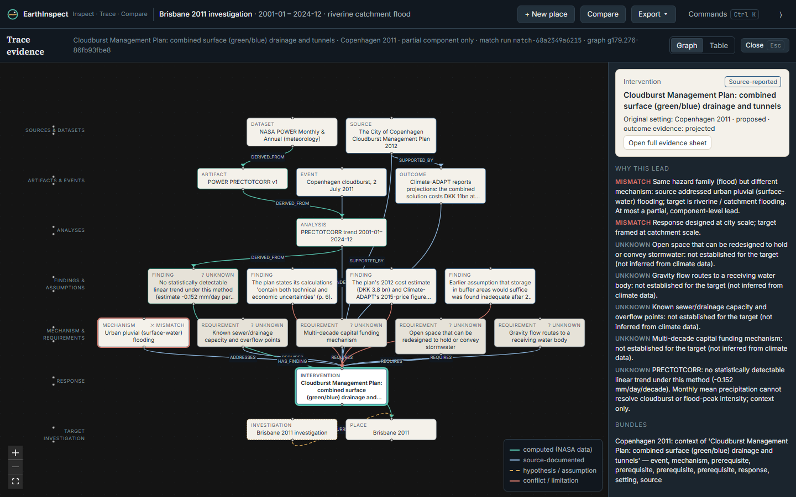

# EarthInspect

**Inspect the change. Trace the evidence. Compare what might transfer.**

EarthInspect helps people investigate environmental change, compare lessons from past disasters, and trace every planning lead back to its contextual assumptions, measured findings, and original sources. Built for the NASA Space Apps 2026 challenge *Earth System Trend Detective*.



## What it does
1. **Regional NASA time series → rate of change → uncertainty.** It acquires NASA POWER monthly T2M, PRECTOTCORR, RH2M and WS10M (MERRA-2-derived) for a region as an area-weighted grid mean. It fits OLS with a linear trend plus calendar-month effects and HAC (Newey–West, 12 lags) standard errors, with a 24-lag sensitivity check. Each result reports the slope per decade, a 95% CI, p, and a Benjamini–Hochberg q across the variable family. Non-significant results are shown, not hidden.
2. **Four source-backed case files.** Copenhagen 2011 cloudburst, Brisbane 2011 river flood, Camp Fire 2018, and Cape Town 2015–2018. Each records event facts, documented responses (implemented, proposed, or retrospective), and observed vs projected outcomes, all with page or section locators.
3. **Evidence graph with hyperedges.** A typed SQLite graph (Place, Event, Variable, Dataset, Artifact, Analysis, Finding, Source, Intervention, Requirement, Outcome, Investigation, Mechanism, Assumption) plus relationship bundles with member roles.
4. **Explainable cross-graph matching.** Rule-based, not a trained model. It classifies each documented response for a target as a *candidate lead*, *needs local evidence*, *partial (component only)*, or *excluded*. For each it lists matched features, mismatches, unknown prerequisites, and the next evidence needed. The score is ordinal, not a probability.
5. **Copilot that executes real tools.** It calls `search_datasets`, `inspect_availability`, `acquire_series`, `analyze_trend`, `compare_variables`, `query_evidence_graph`, `retrieve_precedents`, `evaluate_transfer`, `save_hypothesis` and `export_investigation`, and streams a log of real execution events. Unsupported claims are stripped before display. Without a model key, **Guided analysis** runs the same tools from deterministic templates.
6. **Trace evidence.** A layered graph view, plus a table view, runs from any planning lead to its NASA artifact hash and its historical source.
7. **Evidence revisions.** You can add a planning assumption or link a source. Revisions are immutable, a "What changed?" view compares them, and NASA artifacts are reused rather than refetched.
8. **Any place.** A geocoder or coordinates feed the same pipeline. Exports are CSV, JSON, and a printable HTML report.

## Quick start (Windows PowerShell; macOS/Linux analogous)
```powershell
cd backend
python -m venv .venv
.\.venv\Scripts\pip install -r requirements.txt
cd ..\frontend
npm ci
npx vite build
cd ..\backend
.\.venv\Scripts\python -m scripts.prewarm      # optional: fetch real NASA data for the 4 cases (~15 s)
.\.venv\Scripts\python -m uvicorn app.main:app --port 8000
# open http://127.0.0.1:8000
```
Optional LLM copilot: set `ANTHROPIC_API_KEY` (and optionally `ANTHROPIC_MODEL`, default `claude-opus-5-5`) before starting the server. Keys never reach the browser.

Offline: `backend/snapshots/` holds the previously acquired real NASA POWER responses for the four cases, with their retrieval dates. They are used only if NASA POWER is unreachable.

Container: `docker build -t earthinspect . && docker run -p 8000:8000 -v earthinspect-data:/data earthinspect`. The Dockerfile is provided, but it **has not been built or run here** because Docker isn't installed in the build environment.

## Checks
```powershell
cd backend
.\.venv\Scripts\python -m pytest -q tests          # numerical, cache-key, matching, isolation tests
.\.venv\Scripts\python scripts\e2e_check.py         # 31 end-to-end API checks against a running server
.\.venv\Scripts\python -m scripts.eval_retrieval    # 8-question graph vs keyword smoke test
```
Results are in [VERIFICATION.md](VERIFICATION.md). Demo script: [docs/DEMO_SCRIPT.md](docs/DEMO_SCRIPT.md). Submission copy: [docs/SUBMISSION.md](docs/SUBMISSION.md).

## Data & credits
- NASA POWER (NASA Langley Research Center), monthly API v2.10.0, MERRA-2-derived meteorology
- NASA GIBS (EOSDIS): MODIS Terra Corrected Reflectance, Blue Marble shaded relief, coastlines and reference labels
- NASA Earthdata CMR: catalog verification
- Open-Meteo Geocoding API (GeoNames data): place search
- Historical sources: Climate-ADAPT / City of Copenhagen; Australian Bureau of Meteorology, AIDR and Queensland Government; NIST (TN 2252); City of Cape Town. Links are in each case file.

## Limits (read before using)
- POWER is coarse (0.5° × 0.625°), reanalysis-derived, monthly. It cannot show cloudburst intensity, inundation, fire spread or reservoir storage.
- The four cases are curated examples, not a validated disaster-prediction dataset. The matching rules and "decisive" prerequisite flags are analyst judgements and are labelled as such.
- There is no live rescue routing, event forecasting, causal attribution, or trained link-prediction model.
